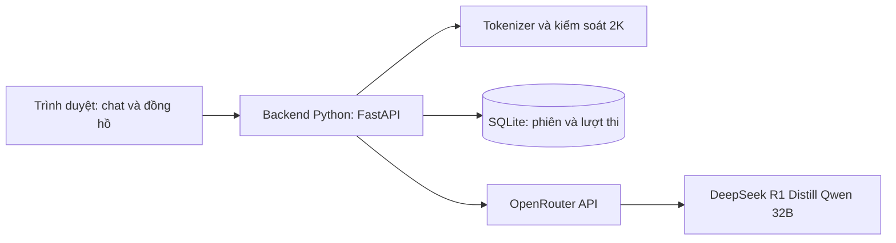

# Kế hoạch trợ lý luyện VOAI 2025 qua OpenRouter

Ngày kiểm tra: 04/10/2026 (Asia/Bangkok).

## 1. Mục tiêu và độ tương đồng

Tạo ứng dụng chat cá nhân dùng `deepseek/deepseek-r1-distill-qwen-32b`, với giới hạn context 2.048 token do người dùng yêu cầu. Máy cá nhân chỉ chạy web server, lưu lịch sử và tokenizer; không tải trọng số hay chạy suy luận LLM.

Nguồn quy định: `D:/OlpAI/Đề thi VOAI2025.pdf`, trang 2-3. Đây là đề VOAI 2025, không phải bằng chứng về quy định OlpAI sinh viên 2026.

| Hành vi | Nguồn | Cách mô phỏng |
|---|---|---|
| DeepSeek-R1-Distill-Qwen-32B | PDF trang 2 | Cố định model ID; không chuyển sang model khác khi lỗi |
| Dùng chat qua trình duyệt | PDF trang 2 | Web chat tiếng Việt |
| Chỉ hỗ trợ tư duy và phát triển mô hình | PDF trang 2 | Hỏi đáp, viết/giải thích code; người dùng tự chạy notebook |
| Thi 6 giờ, AI dùng trong 5 giờ đầu | PDF trang 2 | Đồng hồ thi; backend khóa AI ở mốc 5 giờ |
| Private test mở trong giờ cuối | PDF trang 2 | Nhắc mốc private test; không giả lập quyền truy cập dataset của BTC |
| Context 2K mỗi phiên | Người dùng bổ sung | Mặc định 2.048 token; có cấu hình đổi thành 2.000 |
| Không search hoặc truy cập web | Người dùng yêu cầu để mô phỏng offline | Backend không cấp search, tools, plugins hoặc tải nội dung URL |

Không thể cam kết câu trả lời giống hệt BTC: tài liệu không công bố system prompt, sampling, quantization, provider, giao diện và cách xử lý context. Cloud qua OpenRouter cần Internet, khác hạ tầng offline trong đề. Mục tiêu là mô phỏng hành vi và các giới hạn đã biết.

Phạm vi bản đầu: trợ lý chat và đồng hồ luyện thi. Không bao gồm GPU huấn luyện, hệ thống nộp/chấm bài, cấp tài khoản cho nhiều đội, hoặc sửa file notebook tự động.

## 2. Điều kiện OpenRouter hiện tại

Đã gọi API công khai ngày 04/10/2026:

- `GET https://openrouter.ai/api/v1/models/deepseek/deepseek-r1-distill-qwen-32b/endpoints`
- `GET https://openrouter.ai/api/v1/models/deepseek/deepseek-r1-distill-qwen-32b:free/endpoints`

Cả hai trả về `data.endpoints = []`. Tại thời điểm kiểm tra, chưa có endpoint được liệt kê để phục vụ model qua OpenRouter. Đây là kiểm tra catalog, chưa phải phép thử completion có API key.

Trước lần chạy thật, kiểm tra lại endpoint và thực hiện một completion ngắn có xác thực. Không suy ra khả năng gọi chỉ từ trang giới thiệu model. Không tự dùng R1 full, R1 70B hoặc model khác. Nếu endpoint vẫn trống, giao diện báo model chưa khả dụng và giữ nguyên cấu hình.

Có thể xây và kiểm thử giao diện/backend bằng dữ liệu giả trong thời gian chờ; chế độ này phải ghi rõ "Mô phỏng - chưa gọi model". Muốn dùng ngay khi OpenRouter vẫn không phục vụ sẽ cần người dùng đổi yêu cầu nhà cung cấp; không tự chuyển.

## 3. Thiết kế trải nghiệm

Giao diện một màn hình, dùng tốt trên laptop:

- Cột trái: danh sách phiên, nút "Phiên mới", phiên cũ chỉ đọc khi đầy.
- Vùng giữa: tin nhắn, Markdown, code block và nút copy; phần reasoning có thể thu gọn nếu provider trả về.
- Vùng nhập: dán câu hỏi/code, gửi, dừng sinh; không tự chạy code.
- Thanh trạng thái: model, kết nối, context đang dùng và ngân sách trả lời còn lại.
- Chế độ thi: thời gian còn lại, mốc khóa AI và mốc hết giờ.

Hai chế độ:

1. Luyện tự do: giới hạn context vẫn áp dụng, không có đồng hồ thi.
2. Thi thử: 6 giờ; hết 5 giờ không gửi được câu hỏi mới, mọi phiên đều khóa AI. Phiên mới không đặt lại đồng hồ. Hết 6 giờ đánh dấu kết thúc.

Khi bắt đầu thi thử, hỏi xác nhận ngay trong ứng dụng và tạo một `exam_run` mới. Không khởi động đồng hồ chỉ vì mở trang. Reload hoặc đóng/mở app không đặt lại thời gian. Người dùng có thể chủ động tạo một bài thi thử khác, được ghi riêng trong lịch sử.

Mốc đúng 5 giờ: hủy request đang sinh theo thời gian backend; lưu phần đã nhận với nhãn "Bị dừng khi hết giờ dùng AI". Hủy stream không đảm bảo provider dừng tính phí ngay.

## 4. Định nghĩa giới hạn 2K

Giới hạn context là lượng nội dung được đưa vào một lần suy luận cộng với ngân sách sinh câu trả lời. Nó khác tổng token tính phí: lịch sử được gửi lại qua nhiều lượt nên token tính phí có thể vượt 2.048.

Người dùng đã hỏi lại hành vi của môi trường thi năm ngoái. PDF không nêu hành vi khi đầy context, nên chưa có cơ sở chọn một cách và gọi đó là hành vi chính thức.

Thiết kế `context_policy` có thể cấu hình:

- `new_session`: giữ nguyên toàn bộ lịch sử; khi không đủ chỗ thì yêu cầu phiên mới. Đây là mặc định đề xuất cho bản đầu, có nhãn là giả định luyện tập.
- `sliding_window`: giữ câu hỏi hiện tại, bỏ các cặp hỏi/đáp cũ nhất cho đến khi đủ chỗ cho input và phần sinh; giao diện hiển thị rõ các tin nhắn vẫn lưu để xem nhưng không còn gửi cho model. Nếu riêng câu hỏi mới không vừa, từ chối. Không dùng LLM tóm tắt để tạo thêm bộ nhớ ngoài giới hạn.

Cả hai đều là lựa chọn mô phỏng, không phải quy định được xác nhận từ PDF. Khi có bằng chứng về hệ thống cũ, chọn chính sách tương ứng và giữ một chính sách cố định trong mỗi bài thi thử. Token counter phản ánh context thực sự gửi, không phải toàn bộ lịch sử lưu để xem.

Backend tải tokenizer và chat template đúng từ repository `deepseek-ai/DeepSeek-R1-Distill-Qwen-32B`, cố định revision để tái hiện. Không dùng phép tính ký tự/4 hoặc tokenizer GPT để áp giới hạn. Dữ liệu tokenizer nhỏ hơn rất nhiều so với trọng số model và không yêu cầu GPU.

Công thức dự kiến:

```text
LIMIT = 2048
P = token_count(chat_template(history + new_user_message,
                              add_generation_prompt=true))
MARGIN = 64  # dự phòng ban đầu; cần đối chiếu provider thực tế
R = LIMIT - P - MARGIN
max_tokens = min(OUTPUT_TARGET, R)
```

`OUTPUT_TARGET` ban đầu là 768 và được cấu hình ở backend. Đây là giá trị luyện tập, không phải cấu hình của BTC. Nếu `R < 128`, không gọi API, yêu cầu rút ngắn câu hỏi hoặc tạo phiên mới. Có thể gặp câu trả lời chỉ reasoning hoặc code chưa hoàn chỉnh khi ngân sách quá thấp; hiển thị trạng thái bị cắt, không tự gọi tiếp ngoài ngân sách.

Chỉ đặt `max_tokens=2048` không giới hạn context 2K: tham số đó giới hạn phần sinh, trong khi lịch sử vẫn có thể dài hơn. Phải tính `P` và phần còn lại trước mỗi request.

Tính cả token đặc biệt, role markers, generation prefix và system prompt nếu có. Mặc định không thêm system prompt chưa biết của BTC. `temperature=0.6` là giá trị khởi đầu cho luyện tập, phải ghi rõ chưa xác nhận từ môi trường thi.

Reasoning của lượt hiện tại nằm trong ngân sách sinh; kiểm tra `usage.completion_tokens` và `completion_tokens_details.reasoning_tokens` để tránh bỏ sót hoặc cộng hai lần. Lưu riêng reasoning và final answer nếu có. Khi gửi lịch sử lượt tiếp theo, dùng chat template chính thức; template hiện tại bỏ phần trước `</think>` trong tin nhắn assistant. Nếu provider xử lý khác, ghi lại sai lệch và hiệu chỉnh; không giả vờ rằng hidden reasoning được gửi lại nguyên vẹn.

Đối chiếu `P` với `usage.prompt_tokens` sau mỗi call. Margin 64 chỉ là dự phòng, không chứng minh một hard cap tuyệt đối khi chưa biết upstream template. Chỉ đánh dấu "đã xác minh giới hạn 2K" sau kiểm thử tokenizer/template, provider và reasoning trên endpoint thật. Nếu số đo vượt giới hạn, khóa gửi tiếp, ghi nhận vi phạm và điều chỉnh cách tính; không chỉ cắt chữ trên giao diện để che vượt giới hạn.

## 5. Kiến trúc đề xuất



Frontend HTML/CSS/JavaScript thuần; backend Python/FastAPI, HTTP client streaming, SQLite và tokenizer chính thức. Đây là lựa chọn đơn giản cho ứng dụng một người dùng, phù hợp folder hiện tại chưa có web app sẵn.

App chạy trên `127.0.0.1`, model chạy trên cloud. Chưa cần thuê GPU, deploy website hay đăng nhập nhiều người dùng. API key dùng biến môi trường `OPENROUTER_API_KEY`, chỉ backend đọc; `.env` phải bị loại khỏi Git. Không gửi key xuống trình duyệt hoặc ghi vào log/export.

Cấu trúc dự kiến:

```text
olpai-practice-chat/
  PLAN.md
  README.md
  .env.example
  .gitignore
  requirements.txt
  app/
    main.py
    chat_service.py
    context_budget.py
    exam_clock.py
    storage.py
    openrouter_client.py
    static/
  tests/
  data/                 # SQLite, tokenizer cache; không commit
```

Lưu `exam_runs`, `sessions`, `messages`, `generations`. Generation lưu request ID, model, provider nếu có, usage/cost, finish reason, thời gian, trạng thái và token ước tính/đo thực tế. Một phiên chỉ có một request đang chạy; dùng khóa và idempotency để tránh gửi kép hoặc vượt context từ hai tab.

Các API nội bộ chính: tạo/list phiên, lấy lịch sử, gửi/stream tin nhắn, dừng generation, bắt đầu/lấy trạng thái bài thi thử, xem model availability và export lịch sử.

Backend xác thực thời gian, context và model mỗi lần gửi; không tin timer hoặc token counter từ trình duyệt. Frontend không được gửi tùy ý model ID, lịch sử sửa lại hoặc tăng token cap.

## 6. Gọi OpenRouter và xử lý lỗi

### Chế độ mô phỏng offline bắt buộc

Đây là giới hạn năng lực được thực thi bằng ứng dụng, không chỉ một câu nhắc trong prompt:

- Backend tự tạo payload bằng danh sách trường cho phép. Không nhận payload OpenRouter tùy ý từ frontend; không truyền `tools`, `tool_choice`, web plugins, server tools, file-parser, context-compression hoặc browsing configuration.
- Model ID cố định, không thêm `:online`, không bật router/fallback sang model khác. Không cho người dùng hoặc nội dung chat thay đổi cấu hình này.
- Model chỉ nhận văn bản nhập/dán và lịch sử trong context. Nếu người dùng dán URL, URL là văn bản; backend không tải trang, preview, metadata hoặc tài liệu ở đó.
- Không dùng RAG, nguồn tìm kiếm, bộ nhớ từ phiên khác hoặc ghi chú ẩn để bổ sung kiến thức ngoài context. Phiên mới không nhận nội dung phiên cũ.
- Không cấp đọc file, terminal, Python, truy cập notebook hoặc tự chạy code. Code trong câu trả lời chỉ là văn bản để người dùng copy sang môi trường làm bài.
- Giao diện không tự tải ảnh từ Markdown của model; không render HTML/script thực thi. Không nhúng CDN, analytics hoặc link preview. Link bên ngoài không tự mở; trong thi thử vô hiệu thao tác mở link từ câu trả lời. Điều này chỉ kiểm soát ứng dụng, không khóa các tab khác trên máy người dùng.
- Kết nối runtime ra ngoài chỉ dành cho OpenRouter completion/kiểm tra khả dụng và usage cần thiết. Tải tokenizer, frontend assets và dependency trước buổi thi thử; tokenizer được đọc từ cache local khi làm bài.
- Nếu provider trả về yêu cầu gọi tool hoặc dấu hiệu kết quả tìm kiếm, không thực thi; báo lỗi cấu hình và lưu sự kiện để điều tra. Chọn provider có cam kết không bổ sung browsing; log payload của ứng dụng chỉ chứng minh ứng dụng không yêu cầu search, không chứng minh toàn bộ nội bộ hạ tầng provider.

Trợ lý vẫn có thể trả lời từ kiến thức đã học trong trọng số. "Không search" không đồng nghĩa xóa kiến thức huấn luyện. Nó có thể viết code có `pip install`, tải dataset hoặc HTTP request trong câu trả lời, nhưng ứng dụng không thực thi các lệnh đó; tính hợp lệ của việc chạy chúng phụ thuộc môi trường/quy chế bài thi riêng.

Không thêm lời nhắc dài giả làm system prompt của BTC vì chưa biết prompt gốc, và prompt đó sẽ chiếm context 2K. Cấm search được đảm bảo ở cấu hình API và backend. Không cam kết hạ tầng offline vật lý: suy luận qua OpenRouter vẫn cần Internet, nội dung chat được gửi tới dịch vụ cloud.

Endpoint completion: `POST https://openrouter.ai/api/v1/chat/completions`.

Payload chứa model ID cố định, `messages`, `stream=true`, `max_tokens` tính từ ngân sách và `temperature=0.6`. Không bật web search, file parser, tool execution hay context compression. Giữ chức năng trợ lý trong phạm vi chat hỗ trợ tư duy/code.

Khi có endpoint hoạt động, chọn một provider phù hợp rồi cố định bằng provider selection; không dựa vào routing ngẫu nhiên để tái hiện cấu hình. Kiểm tra provider hỗ trợ các tham số giới hạn; yêu cầu tham số được hỗ trợ. Tắt chuyển provider nếu mục tiêu là so sánh nhất quán. Không truyền model fallback.

Lưu final usage từ SSE. Phân biệt stop, length, lỗi giữa stream và người dùng hủy. Lỗi sau khi đã nhận nội dung phải giữ bản nháp có nhãn; không tự retry completion và tính phí lần nữa. Retry chỉ các truy vấn availability hoặc theo thao tác gửi lại có chủ đích của người dùng.

Hiển thị lỗi dễ hiểu cho thiếu key, không có endpoint, hết credit, rate limit, timeout và lỗi provider. Không công bố giá ước đoán: lấy pricing từ endpoint khả dụng và tổng hợp usage/cost thực tế.

## 7. Lộ trình thực hiện

1. Giữ cách xử lý phiên đầy là cấu hình có nhãn chưa xác nhận; kiểm tra lại model và endpoint. Ghi rõ cấu hình đã biết/chưa biết.
2. Xây tokenizer budget, SQLite, trạng thái thi và kiểm tra backend. Chưa cần key để kiểm thử bằng mock.
3. Làm giao diện chat, token counter, copy code, phiên mới, lịch sử và đồng hồ.
4. Tích hợp OpenRouter/SSE. Người dùng cấu hình key trên máy; thực hiện completion ngắn khi có endpoint, đối chiếu usage/template/reasoning.
5. Chạy kiểm thử ranh giới 2K, nhiều lượt, timer, reload, đồng thời hai tab, lỗi/hủy stream. Sau đó thử một buổi luyện thực tế và hoàn thiện README.

Không triển khai dịch vụ công khai trong bản đầu. Việc phát hành/hosting có thể làm sau nếu người dùng muốn.

## 8. Tiêu chí nghiệm thu

- Model ID cố định đúng 32B; không âm thầm chuyển sang model khác.
- Prompt dài bị từ chối trước khi gọi API; input + ngân sách output + dự phòng không vượt 2.048 theo bộ đếm đã định nghĩa.
- Cách đếm được xác minh với endpoint thật; có kiểm thử tiếng Việt, code, role markers, nhiều lượt và reasoning. Nếu chưa có endpoint, trạng thái nghiệm thu tích hợp là chưa xác minh.
- Phiên mới tách lịch sử; mặc định phiên đầy không tự tóm tắt/cắt lịch sử. Nếu chọn sliding window, cắt đúng cặp hỏi/đáp và đánh dấu phần không còn trong context.
- Backend khóa toàn bộ phiên của bài thi thử ở giờ thứ 5; reload và phiên mới không kéo dài hạn.
- Request đang chạy, hủy, lỗi giữa stream và gửi kép không làm hỏng lịch sử hoặc gọi tính phí lặp một cách âm thầm.
- API key không có trong HTML, bundle JavaScript, log hoặc export.
- Chat lưu và export được; code copy nguyên định dạng; có cảnh báo khi câu trả lời bị cắt.
- Không gọi tool/web, không đọc hoặc chạy notebook tự động.
- Kiểm thử đối kháng: yêu cầu "search web", URL bất kỳ, chèn `:online`/tools/plugins từ client, tool call từ provider, ảnh/link trong Markdown và hỏi về phiên trước. Không có tìm kiếm/tải URL/chạy tool hoặc rò lịch sử giữa phiên; kiểm tra payload thực tế tới OpenRouter.

## 9. Tham khảo

- Quy định: PDF local trang 2-3 như đã nêu.
- OpenRouter API và usage: https://openrouter.ai/docs/api/reference/overview
- Provider selection: https://openrouter.ai/docs/guides/routing/provider-selection
- Reasoning token handling: https://openrouter.ai/docs/guides/best-practices/reasoning-tokens
- Tokenizer/chat template chính thức: https://huggingface.co/deepseek-ai/DeepSeek-R1-Distill-Qwen-32B/blob/main/tokenizer_config.json

## 10. Trạng thái triển khai

Đã xây bản đầu trong folder này: backend FastAPI/SQLite, tokenizer chính thức được cache local, giao diện chat, stream/copy/export, hai chính sách context và chế độ thi thử 5/6 giờ. Có `run.ps1`, `.env.example`, virtualenv, tokenizer cache và hướng dẫn README.

18 kiểm thử đã pass, gồm template tiếng Việt/code/reasoning, biên 2K, bỏ lịch sử theo cặp, cô lập phiên, thiếu endpoint/key, whitelist payload, tool-call bị chặn, usage vượt giới hạn, restart, hủy stream, hai tab và khóa request đang sinh ở hạn AI. Giao diện đã được thử bằng demo; demo có nhãn và database riêng.

Chưa có credential thật và endpoint OpenRouter hiện trống, nên chưa gọi completion thật/có phí. `context_verified` vẫn là false: hard cap upstream và độ tương đồng với provider BTC chưa được nghiệm thu. Bản đầu dành cho một người dùng local, một worker; không triển khai hệ thống nhiều người dùng hoặc chống sửa đồng hồ/database.

## 11. Cloudflare Workers AI

Backend mặc định chuyển sang Cloudflare, model cố định `@cf/deepseek-ai/deepseek-r1-distill-qwen-32b` qua API tương thích Chat Completions. `OLP_BACKEND` chọn Cloudflare hoặc OpenRouter; không fallback giữa hai bên. Token và Account ID đặt trong `.env`, không gửi ra UI/export. Account ID được kiểm tra 32 ký tự hex trước mọi request.

Nút kiểm tra gọi danh mục model có xác thực, không tạo completion. Stream yêu cầu usage và xử lý reasoning_content; các quy tắc 2K, không tool/search và timer 5/6 giờ giữ nguyên. SQLite tự thêm metadata backend/model cho lượt mới và giữ lịch sử cũ. Bộ kiểm thử hiện có 31 trường hợp, dùng mock, không tính phí. Chưa xác minh inference thật vì chưa có credential Cloudflare; `context_verified` vẫn false.

Tài liệu: https://developers.cloudflare.com/workers-ai/get-started/rest-api/ và https://developers.cloudflare.com/workers-ai/models/deepseek-r1-distill-qwen-32b/ .

## 12. Sửa sai lệch reasoning trong lịch sử

Phát hiện Cloudflare giữ reasoning khi caller gửi lại nội dung <think>...</think>, trong khi template HF local loại bỏ nó. Các lượt thứ hai bị báo sai lệch dù usage tổng chưa vượt 2K. prepare_messages giờ đồng bộ nội dung assistant gửi API với nội dung được template local đếm; không sửa bản gốc lưu/hiển thị. Startup khôi phục riêng các phiên Cloudflare bị khóa do lỗi template có usage hợp lệ <=2K, giữ audit và thời gian thi. Không mở lại khóa do thiếu usage/vượt context/hết giờ. Thêm kiểm thử ba lượt với provider giữ reasoning và các trường hợp khôi phục; 37 kiểm thử pass.
